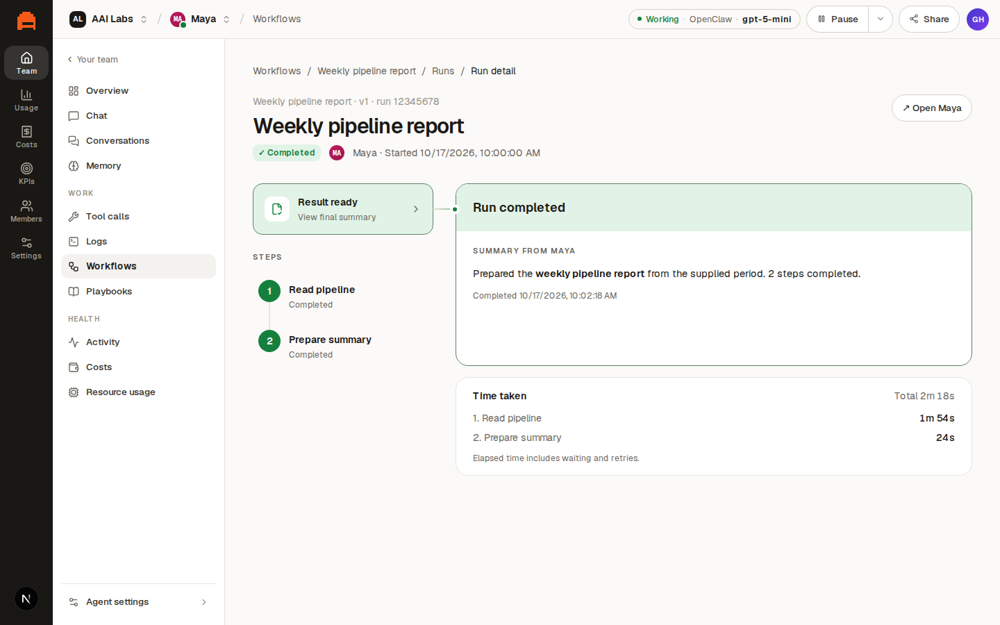

<div align="center">


<a id="agent-barn"></a>

# Agent Barn — self-hosted AI agent control plane

**AI coworkers in Slack, Microsoft Teams, Telegram, and Discord, running on your infrastructure.**

[](LICENSE)
[](https://discord.gg/A3vJF5ZKnu)

[Website](https://agentbarn.dev) · [Docs](https://agentbarn.dev/guides) · [Quick start](#quick-start) · [Discord](https://discord.gg/A3vJF5ZKnu)

</div>

---

Agent Barn is an open-source, self-hosted AI agent control plane for teams that
want to operate OpenClaw and Hermes agents on their own Kubernetes infrastructure.
Connect agents to Slack, Microsoft Teams, Telegram, or Discord; give each a role,
model, and tool access; then review its activity and costs from one place.



*UI preview using synthetic Playwright fixtures. The screenshot illustrates the
workflow interface, not a live model run or a performance benchmark.
[Capture context](docs/features/agent-workflows/evidence/af-389/README.md).*

| Start with | Configure | Check the result |
| --- | --- | --- |
| Turn a Slack request into a Jira task | Jira Task Helper template, a Slack Connection, and a scoped Jira credential | Review the draft before confirming creation; check the resulting issue key. |
| Review a pull request | PR Reviewer template and access to the intended repository | Read the review and compare its findings with the actual diff. |
| Report on team activity | General Purpose agent with access to the chosen source systems | Ask for a bounded report with source links; verify its facts and per-agent cost. |

These are setup examples, not preconfigured integrations or guaranteed outcomes.
[Follow the workflow walkthroughs](docs/use-cases.md),
[install locally](#quick-start), or explore
[managed plans and pilots](https://agentbarn.dev/pricing).

- **Talk to your tools.** Agents live in Slack, Microsoft Teams, Telegram, and Discord.
- **A model per agent.** Each gets its own virtual key on a LiteLLM proxy in your namespace.
- **See what it costs.** Per-agent token and spend attribution, not one opaque monthly number.
- **Multi-tenant from the start.** Organisation roles and per-agent access roles, isolated in the data layer.
- **Audit what happened.** Conversation history, a tool-call log, and a domain-event trail.
- **Self-host it.** Helm charts, Helmfile, PostgreSQL, your cluster.

Everything runs in your namespace: the control plane, the database, the model
proxy, and one pod per running agent. Outbound traffic goes to OpenRouter through
the LiteLLM proxy you operate, to whichever tool APIs you connect, and, for installs
that keep it on, to Agent Barn's product analytics
([usage analytics](#usage-analytics)).
Credentials are encrypted at rest in your own PostgreSQL.

## Contents

- [Common questions](#common-questions)
- [Workflow walkthroughs](docs/use-cases.md)
- [Quick start](#quick-start) — [before you begin](#before-you-begin), then six steps to a running agent
- [What ships in the box](#what-ships-in-the-box) — [agents](#agents), [skills](#skills), [runtimes](#runtimes)
- [Capabilities](#capabilities)
- [Development](#development) — [native](#native-non-docker-development), [k3d](#local-kubernetes-k3d), [migrations](#database-migrations), [tests](#tests-and-checks), [troubleshooting](#troubleshooting)
- [Deploying to Kubernetes](#deploying-to-kubernetes) — [usage analytics](#usage-analytics), [connecting agent email](#connecting-agent-email-manual-step), [connecting OneDrive](#connecting-onedrive-manual-step)
- [Repository layout](#repository-layout)
- [Getting help and contributing](#getting-help-and-contributing)

## Common questions

### How do I run OpenClaw and Hermes together?

Choose a runtime per Agent. Agent Barn manages their Kubernetes resources,
configuration, Skills, and lifecycle in the same control plane. It does not
replace either runtime, and their command-approval behavior differs.
[Runtime selection and boundaries](docs/use-cases.md#run-openclaw-and-hermes-together).

### How do I connect a Slack agent to Jira?

Connect Slack for messaging and attach a separate Jira credential and Skill for
tool access. The Jira Task Helper drafts a ticket and asks for confirmation
before creating it. [Slack-to-Jira walkthrough](docs/use-cases.md#turn-a-slack-request-into-a-jira-task).

### How do I track costs separately for each AI agent?

Each Agent has its own LiteLLM virtual key. Imported cost records attribute calls
to an Agent and Organization; recent calls can take time to appear after cost
synchronization. [Cost checks and limits](docs/use-cases.md#track-per-agent-model-costs).

### What does Agent Barn add to running an agent runtime directly?

Agent Barn adds shared administration: Organizations, Agent Access, reusable
Templates and Skills, Kubernetes lifecycle management, conversation and tool-call
history, and per-agent spend reporting. Your team still operates the cluster,
connected tools, and model-provider configuration.
[Architecture](docs/architecture/system-map.md) ·
[Self-hosting](https://agentbarn.dev/guides/self-hosting).

## Quick start

Start the full local stack — control plane, database, model proxy, and the
Kubernetes cluster agents run on — and hire your first agent. The step-by-step
version with screenshots is at
[agentbarn.dev/guides/get-started](https://agentbarn.dev/guides/get-started/local-quickstart).

### Before you begin

**Required software**

- **Git** — used to clone the repository.
- **Docker with Compose v2.24 or later** — everything runs in containers, including the local Kubernetes cluster.
- **`bash`** — `run.sh` and `stop.sh` are shell scripts. On Windows, see [Windows](#windows).
- **`kubectl`** — used to seed the cluster namespace and secret.
- **[uv](https://docs.astral.sh/uv/)** — runs the host-side Garage bootstrap with Python 3.14; uv can download the managed interpreter.
- **OpenSSL** — used below to generate local keys.
- **curl** — used by the verification steps.

Containerized startup still needs uv/Python for storage bootstrap; installing uv
lets it supply the managed Python interpreter. Node.js and pnpm are needed only
for native UI development, tests and lint (see [Development](#development)).

**Required credentials**

1. An **[OpenRouter](https://openrouter.ai) API key** — every agent's model calls route through it.

**Local ports** — these must be free:

| Port    | Service                    |
| ------- | -------------------------- |
| `3000`  | UI                         |
| `3900`  | Garage S3 (loopback only; configurable) |
| `5432`  | PostgreSQL                 |
| `7070`  | LiteLLM proxy              |
| `8000`  | API                        |
| `8001`  | Ingest (runtime telemetry) |
| `8002`  | Communications gateway     |
| `8003`  | Agent Memory gateway       |
| `8004`  | Credential gateway         |
| `16443` | k3d Kubernetes API         |

Make sure these ports are free before starting the full stack. The configurable
ports are identified in `.env.spec` and the k3d helper scripts.

### 1. Clone the repository

```bash
git clone https://github.com/aai-labs/agent-barn.git
cd agent-barn
```

### 2. Create the local configuration

```bash
cp .env.spec .env
```

Now fill in these values. Every option in `.env.spec` is commented, and
anything not listed here has a working local default:

| Variable                                            | What to put in it                                                                                                       |
| --------------------------------------------------- | ----------------------------------------------------------------------------------------------------------------------- |
| `POSTGRES_USER`, `POSTGRES_PASSWORD`, `POSTGRES_DB` | local credentials and a database name; the database is created on first run                                             |
| `POSTGRES_PORT`                                     | a free host port; keep the default `5432` when available                                                                |
| `SECRET_SIGNING_KEY`                                | any random string                                                                                                       |
| `PLATFORM_ADMIN_CREDENTIALS`                        | `email:password` for the admin account created at startup — the password needs 8+ characters, upper, lower, and a digit |
| `ENVIRONMENT`, `WEB_APP_URL`, `API_PORT`            | leave the `.env.spec` defaults                                                                                          |
| `AGENT_TOKEN_ENCRYPTION_KEY`                        | a Fernet key — generate it below                                                                                        |
| `OPENROUTER_API_KEY`                                | optional; your OpenRouter key, used until a key is saved in Platform Admin settings                                     |
| `LITELLM_MASTER_KEY`                                | a **stable** admin key — generate it below                                                                              |
| `LITELLM_SALT_KEY`                                  | a **permanent** key that encrypts provider keys stored in LiteLLM — generate it below                                   |
| `AGENT_LITELLM_BASE_URL`                            | `http://host.docker.internal:7070` so agent pods can reach LiteLLM through the host                                     |
| `OPENCLAW_IMAGE`, `HERMES_IMAGE`                    | full `name:tag`; each tag must equal the matching `openclaw-base/VERSION` / `hermes-base/VERSION`                       |

Generate the three keys:

```bash
# AGENT_TOKEN_ENCRYPTION_KEY — encrypts platform credentials at rest
openssl rand -base64 32 | tr '+/' '-_'

# LITELLM_MASTER_KEY
echo "sk-$(openssl rand -hex 16)"

# LITELLM_SALT_KEY
openssl rand -hex 32
```

> [!IMPORTANT]
> `LITELLM_SALT_KEY` must never change: LiteLLM encrypts the provider keys it
> stores with it and cannot decrypt them under a different value.

You don't need to touch `API_K8S_KUBECONFIG_PATH` — `run.sh` sets it for you once
the cluster is up.

### 3. Start Agent Barn

```bash
./run.sh
```

This validates `.env`, bootstraps persistent private Garage storage, brings up
the k3d cluster and LiteLLM, builds and loads the agent base images, starts `db`
and `redis`, runs database migrations, then starts `api`, `worker`, `sync-engine`,
`communications`, `memory`, `artifact-purge`, `workflow-maintenance`, and `ui` with hot reload and follows
the logs. `Ctrl-C` detaches without stopping anything; use `./run.sh --detach`
to skip the logs entirely.

The memory gateway needs a running Hindsight backend to list or save memories.
The optional `local-hindsight` Compose profile provides one; see
[Agent Memory deployment](docs/guidelines/operations.md#agent-memory-deployment).

If a startup value checked by `run.sh` is missing, the script fails immediately
and lists it.

> [!NOTE]
> The **first** run builds both agent base images from scratch and takes a
> while. Later runs skip any image tag already present in the cluster.

### 4. Verify the environment

The API reports its own database connectivity:

```bash
curl -s localhost:8000/api/v1/health
# {"status":"ok","db":"connected"}
```

Then check the UI answers and every container is healthy:

```bash
curl -s -o /dev/null -w '%{http_code}\n' localhost:3000   # → 200
docker compose ps                                          # all Up / healthy
```

Finally, confirm the cluster agents will run on is ready and its namespace was
seeded:

```bash
export KUBECONFIG=.k3d/kubeconfig-host.yaml
kubectl get nodes            # one Ready node
kubectl get ns agent-farm    # Active
```

> [!NOTE]
> The namespace is `agent-farm`, not `agent-barn`. Kubernetes namespaces were
> deliberately left unrenamed in the rebrand — moving running workloads would
> mean recreating every agent Deployment and PVC.

### 5. Sign in

Open **`http://localhost:3000`** and log in with the `email:password` you set in
`PLATFORM_ADMIN_CREDENTIALS`.

> [!TIP]
> If the API exited at startup with `500: Error while initializing startup data`,
> that password almost certainly failed the policy check. See
> [Troubleshooting](#troubleshooting).

### 6. Create an organisation, then hire an agent

Agents are organisation-scoped and a fresh database has none, so **create an
organisation first**. Then pick a template (see
[Agents](#agents)), choose a model, attach any credentials its skills need, and
start it. Connecting it to Slack, Teams, Telegram, or Discord is a per-agent
Communication Connection; the UI walks through each platform's setup.

### Stopping and restarting

| Command             | What it does                                                            |
| ------------------- | ----------------------------------------------------------------------- |
| `./run.sh`          | start everything and follow logs                                        |
| `./run.sh --detach` | same, without following logs                                            |
| `./stop.sh`         | stop containers; DB/redis data and the k3d cluster survive              |
| `./stop.sh --clean` | also delete the k3d cluster (images reload next run); volumes untouched |
| `make restart-ui`   | refresh the running Docker UI after adding an App Router directory      |

`make run`, `make stop`, and `make stop-clean` are thin wrappers around the same
scripts. Volumes are never deleted by either script.

## What ships in the box

### Agents

An agent is a template plus a model, one or more communication connections, and
a set of credentialed skills. These templates ship as seeds:

| Agent               | What it does                                                                                          |
| ------------------- | ----------------------------------------------------------------------------------------------------- |
| PR Reviewer         | Reviews pull requests for correctness, clarity, and style                                             |
| Documentation Agent | Documents merged pull requests into Confluence, keeps a changelog, and posts a weekly digest to Slack |
| Email Reminder      | Monitors a mailbox, flags action-required mail, and posts P1/P2 pings to Slack                        |
| Jira Task Helper    | Turns a plain-language request, in any language, into a structured Jira task                          |
| Scrum Master        | Runs sprint ceremonies, tracks blockers, keeps the team on cadence                                    |
| General Purpose     | One flexible assistant for ad-hoc work                                                                |

Templates are content, not code: a `settings.yaml` plus Markdown artifacts
(`soul`, `identity`, `user`, `tools`, `agents`, `boot`, `bootstrap`,
`heartbeat`), with anything a template omits inherited from shared defaults.
The seeds in
[`api/domains/templates/predefined/seeds/`](api/domains/templates/predefined/seeds/)
bootstrap the platform lineages once; after that, new versions are authored
through the platform admin flow, and organisations fork or override them per
agent. Details:
[`docs/features/templates-and-skills.md`](docs/features/templates-and-skills.md).
See [Templates and Skills documentation](https://agentbarn.dev/guides/templates-and-skills/templates)
for the template model, [workflow walkthroughs](docs/use-cases.md) for setup examples,
and [agentbarn.dev/recipes](https://agentbarn.dev/recipes) for a guided setup per template.

### Skills

Skills are what agents can actually do:

Apollo · Bitbucket · Confluence · Excel · GitHub · GitLab · Google Drive · HubSpot ·
Jira · Merkys · OpenPanel · Pipedrive · PostHog · Zoho Mail

Each mounts documentation into the agent's workspace and is gated on the
credential its provider needs, so an agent only gets a skill once the matching
credential is attached. Skills whose credential lifecycle isn't modelled yet
(Excel, Google Drive, HubSpot, OpenPanel, PostHog) are attachable but not
auto-attached — Excel needs no credential at all, since it works on local files.
Agents also reach a self-hosted Firecrawl for web retrieval.

Building one is a
[contribution we'd welcome](CONTRIBUTING.md#contribute-a-template-or-bundled-skill).
Open a Discussion first so we can tell you if one is already in progress.

### Runtimes

Agents run as pods, one per agent, from a pinned base image:

| Runtime  | Base image                         | Notes                                              |
| -------- | ---------------------------------- | -------------------------------------------------- |
| OpenClaw | [`openclaw-base/`](openclaw-base/) | Default runtime; command approval is always `AUTO` |
| Hermes   | [`hermes-base/`](hermes-base/)     | Supports the per-agent command-approval mode       |

Both consume the same runtime-neutral communications protocol, so every platform
works on either runtime. Both are upstream projects; this repository holds the
Dockerfiles that pin and extend them, the telemetry plugins they load, and the
builders that turn an agent record into Kubernetes resources.

## Capabilities

| Area                    | What's there                                                                                                                                                                                                                                 | Docs                                                                                    |
| ----------------------- | -------------------------------------------------------------------------------------------------------------------------------------------------------------------------------------------------------------------------------------------- | --------------------------------------------------------------------------------------- |
| Agent artifacts | Private file publication from chat/workflows, short-lived app download links, per-Agent storage provisioning, infinite artifact lists and permission-gated deletion | [`features/agent-artifacts.md`](docs/features/agent-artifacts.md) |
| Agent lifecycle         | Start, stop, monitor; per-agent model within the organisation's default and allowlist; per-agent channel allowlist and DM policy                                                                                                             | [`features/agents.md`](docs/features/agents.md)                                         |
| Communication           | Slack, Microsoft Teams, Telegram, Discord. An agent may own several connections, including more than one on the same platform. Slack apps are created by hand from a generated manifest; Teams connections export an installable app package | [`features/communications/`](docs/features/communications/)                             |
| Templates and skills    | Versioned templates and skills, seeded on startup, forkable per organisation, with per-agent overrides; agents pin the skill version they run                                                                                                | [`features/templates-and-skills.md`](docs/features/templates-and-skills.md)             |
| Activity                | Conversation history and a tool-call audit log per agent, pushed from the runtime to the ingest API                                                                                                                                          | [`features/activity-and-ingest.md`](docs/features/activity-and-ingest.md)               |
| Costs                   | Per-agent and per-organisation token and spend attribution                                                                                                                                                                                   | [`features/costs.md`](docs/features/costs.md)                                           |
| Identity and access     | Sign-up and sign-in with Google into a trial organization, login, logout, access + refresh tokens in an httpOnly cookie, password change and reset; organisations with fixed permission-backed roles, plus separate per-agent access roles and assignments                                     | [`features/identity-and-organizations.md`](docs/features/identity-and-organizations.md) |
| Platform administration | User and organisation management, platform statistics, and the Event Delivery Monitor                                                                                                                                                        | [`features/platform-administration/`](docs/features/platform-administration/)           |
| Integrations            | Per-agent provider credentials, organisation-scoped shared credentials, Google OAuth for Google Workspace (Gmail, Calendar, Drive, Sheets), and Custom API connections to any public HTTPS API (API key, Bearer, Basic or OAuth2 client credentials) | [`features/integrations.md`](docs/features/integrations.md)                             |
| Domain events           | Transactional outbox, a Dramatiq worker, event handlers, and a security-audit projection                                                                                                                                                     | [`features/domain-events.md`](docs/features/domain-events.md)                           |
| Runtime and deployment  | Kubernetes agent resources, Helm + Helmfile, namespace-scoped Prometheus and Grafana                                                                                                                                                         | [`architecture/runtime-and-deployment.md`](docs/architecture/runtime-and-deployment.md) |

## Development

`./run.sh` is enough for most work. For faster iteration, or to run only part of
the stack, use the native path below. The contribution workflow and engineering
context routes start in [CONTRIBUTING.md](CONTRIBUTING.md).

Native development, tests, and lint additionally need Make, Python `3.14` +
[uv](https://github.com/astral-sh/uv) and Node.js `24` +
[pnpm `11.17.0`](https://pnpm.io/), matching the repository and CI pins.

### Native (non-Docker) development

Each `dev-*` service target watches its own source. Run the ones you need in
separate terminals, alongside `make db-up`:

```bash
make setup         # uv sync + pnpm install; creates .env from .env.spec if absent
make db-up         # Postgres only
make migrate       # apply migrations
make dev-api       # API :8000, Ingest :8001, Communications :8002, Memory :8003, Credentials :8004
make dev-ui        # UI on :3000, hot reload
make dev-worker    # Dramatiq worker, hot reload
make dev-sync-engine  # Sync Engine: Agent file sync, one pass every 30 s
make dev-ingest    # Ingest only (normally started by dev-api)
make dev-communications  # Communications only (normally started by dev-api)
make dev-gateway   # Credential gateway only (normally started by dev-api)
make dev-memory    # Memory gateway only (normally started by dev-api)
make reconcile     # one-shot repair pass for stuck/unpublished deliveries
```

The db/redis targets and `./stop.sh` work before Garage has been configured.
For native file uploads/downloads, run `make garage-up` before `make dev-api`;
this generates private API management settings and a loopback endpoint as well.
Agent creation queues storage without waiting; Artifacts shows progress and lets
existing Agents provision or retry. No separate provisioner service is needed. See [Garage operations](docs/guidelines/garage.md). The full `./run.sh` path starts
Garage and the purge worker automatically, without a profile.

`make db-down` stops PostgreSQL; `make db-logs` and `make db-restart` manage it.
The worker and reconciliation command also need a Redis server reachable at the
`REDIS_URL` in `.env`. The Compose Redis service does not publish a host port,
so `make redis-up` alone cannot serve those host-run processes. This path uses
host ports `3000`, `8000`, `8001`, `8002`, `8003`, and `8004`, so don't run it alongside
`./run.sh`'s containers.

Two gotchas specific to this path:

- **`DB_CONNECTION_URL` must be correct in `.env`.** These targets read it
  directly; the config has no default and doesn't assemble one from the
  `POSTGRES_*` values. `./run.sh` doesn't care, because compose overrides it to
  the in-network `db` hostname.
- **Set `LITELLM_BASE_URL=http://127.0.0.1:7070`.** It's blank in `.env.spec`,
  and unlike the Docker path nothing here fills it in. `create_agent` silently
  skips minting a LiteLLM key when it's empty
  ([agent service](api/domains/agents/service.py), no error either way),
  so the agent is created and _looks_ fine but can never answer.

Starting agents still needs a k3d cluster with loaded images, even natively.
Bring one up with `bash docker/k3d/k3d-up.sh` and
`bash docker/k3d/k3d-load-images.sh`, then point the host API at it:

```bash
export KUBECONFIG="$PWD/.k3d/kubeconfig-host.yaml"
export K8S_KUBECONFIG_PATH="$PWD/.k3d/kubeconfig-host.yaml"
```

### Agent artifacts in development

Local artifacts use a private, single-node Garage container and persistent Docker
volumes. **No AWS account, S3 credentials, GitHub Secrets, or manual Kubernetes
bootstrap is needed locally.** Docker Compose 2.24+ and uv are required. The first
startup generates local credentials in the ignored `.garage/` directory; later
starts reuse them and the existing volumes.

For the full-stack path, complete the `.env` setup above and start the stack:

```bash
./run.sh --detach
```

The launcher prepares Garage, applies the artifact migrations, and starts background
maintenance automatically. After signing in, check storage with:

```bash
make garage-status
# The application services and Garage should be running:
docker compose ps garage api artifact-purge ui
```

Open an Agent's **Artifacts** tab. A new Agent queues private storage setup without
waiting for Garage; the tab shows progress. On an existing Agent, click **Provision**
if storage has not been prepared. Provisioning, retry and deletion require
`agent.update`; users with current `agent.read` access can view and download.

Start the Agent, or update/restart an Agent created before this feature so it gets
the runtime file tool. Ask it to create a small CSV and provide the download link.
The artifact should appear in **Artifacts**; downloading it requests a fresh link.
The trash action opens a confirmation dialog, and files pinned by active runs or
reviews remain protected. This is a developer smoke test; external messaging and
model/tool selection still depend on the configured runtime and provider.

For the native API/UI path, complete the native database/migration setup above,
then prepare storage **before** starting the API:

```bash
make garage-up       # persistent storage + ignored API/native management settings
make garage-status
make dev-api         # terminal 1; loads generated storage settings
# In terminal 2:
make dev-ui
# Recover pending requests / run one bounded cleanup pass when needed:
make purge-artifacts
```

For an Agent running in k3d, `ARTIFACT_RUNTIME_BASE_URL` in `.env` must point to
the native API address reachable from Agent containers. The default uses
`host.docker.internal:8000`; if `API_DEV_PORT` differs, update that URL and restart
the API and the Agent. The browser-facing download origin is `WEB_APP_URL`.

Native post-response provisioning runs immediately, but unattended retry needs the
maintenance worker; `make purge-artifacts` provides an explicit one-shot recovery
pass. Restart the native API after re-running storage bootstrap. Garage management
and per-Agent data credentials stay server-side. Generated private files live in
ignored `.garage/`; keep that directory and the named data volumes intact. Backup,
restore and cluster installation are documented in [Garage operations](docs/guidelines/garage.md).

| Symptom | What to check |
| --- | --- |
| Storage unavailable / not configured | Confirm Docker is running, run `make garage-up`, then restart the API so it loads generated settings. Check `make garage-status`. |
| Garage cannot start on port 3900 | Set `GARAGE_S3_PORT` in `.env` before the first `make garage-up`. Existing initialized stores keep their saved port; follow the operations guide to migrate or restore. |
| Provisioning failed or stays pending | Check `docker compose logs --tail=100 api artifact-purge garage`; in native development run `make purge-artifacts` and retry from Artifacts. |
| Download links use the wrong host/port | `WEB_APP_URL` must match the UI origin that download clients can reach. Adjust it for a second worktree and restart the API. |
| A file uses the previous storage layout | This PR deliberately does not migrate old shared-bucket files. Re-upload or plan a verified migration; provisioning a new bucket does not move old bytes. |
| Delete reports an active pin | The owning run or review must release its reference through its lifecycle before deletion. |

Artifact checks use disposable PostgreSQL/Garage and never need installation
storage credentials:

```bash
make check-api check-ui lint-ui check-migrations
(cd api && uv run pytest tests/integration/test_artifacts.py tests/integration/test_artifact_review.py tests/integration/test_artifact_creation.py -q)
(cd ui && pnpm exec playwright install chromium)
(cd ui && pnpm exec playwright test tests/e2e/artifacts.spec.ts)
```

Helm chart checks and the opt-in real-image/storage/browser contracts have extra
prerequisites. See [artifact test guidance](docs/guidelines/testing.md#agent-artifact-storage-and-runtime-contracts),
[configuration and lifecycle](docs/features/agent-artifacts.md), and
[verification evidence](docs/features/agent-artifacts/EVIDENCE.md) for exact limits,
rollback, test boundaries and recorded results.

### Local Kubernetes (k3d)

Agents run as Kubernetes resources, so `./run.sh` brings up a cluster
automatically. We use [k3d](https://k3d.io) (k3s in Docker) from a helper
container, so no host `k3d` or `helm` install is needed — only Docker and
`kubectl` (the optional [local Prometheus](#resource-usage-local-prometheus) also
needs `helm`). The Kubernetes integration job provisions its own k3d cluster with
[`AbsaOSS/k3d-action`](https://github.com/AbsaOSS/k3d-action).

`./run.sh` drives `docker/k3d/k3d-up.sh` (cluster + LiteLLM) and
`docker/k3d/k3d-load-images.sh` (agent base images). Both are idempotent and
safe to run directly.

> [!IMPORTANT]
> Keep the `OPENCLAW_IMAGE` / `HERMES_IMAGE` tags in sync with
> `openclaw-base/VERSION` and `hermes-base/VERSION`. CI publishes each base image
> under exactly its `VERSION` tag and the API launches pods from these env-var
> refs, so a mismatched tag runs an image that isn't the version the code
> expects. `k3d-load-images.sh` refuses to run otherwise, and skips the build for
> a tag it can already see in the cluster.

<details>
<summary><b>The two kubeconfigs, and how pods reach the host</b></summary>

`./run.sh` writes two kubeconfigs into `.k3d/` (gitignored) — the same cluster,
reached differently depending on where the client runs:

- `.k3d/kubeconfig-host.yaml` — server on `127.0.0.1`, for host tools
  (`kubectl`, `helm`, `make dev-api`).
- `.k3d/kubeconfig-internal.yaml` — server on `host.docker.internal`, for the
  API running **inside** Docker (`run.sh` points `API_K8S_KUBECONFIG_PATH` here
  automatically).

Agent pods inside k3d reach LiteLLM at `http://host.docker.internal:7070`, so
`AGENT_LITELLM_BASE_URL` must use that address (and the selected LiteLLM port).
On
Docker Desktop that name resolves inside pods automatically; on a native Linux
docker engine, `k3d-up.sh` adds a CoreDNS entry (via the `coredns-custom` config
map) mapping it to the cluster network gateway. No manual setup on either
platform.

</details>

<details>
<summary><b>Runtime telemetry — where conversations and tool calls come from</b></summary>

Agents don't store their history in the pod. Runtime plugins push events to the
ingest API and the UI reads what was persisted, so a broken path means agents run
but their activity stays empty.

Ingest listens on `8001`, separate from the main API on `8000`, and pods reach it
through the host via `host.docker.internal`, same as LiteLLM.
`INGEST_BASE_URL=http://host.docker.internal:8001/ingest/v1` is the default for
both `run.sh` and `make dev-api`, overriding the in-cluster Service address that
only applies when the API itself runs in k8s. Override `INGEST_BASE_URL` (or
`INGEST_PORT`) for a different address.

To check the hop from inside the cluster:

```bash
kubectl run ingest-check --rm -it --restart=Never --image=curlimages/curl -- \
  curl -sS -o /dev/null -w '%{http_code}\n' \
  http://host.docker.internal:8001/ingest/v1/openapi.json
```

`200` means it works; the event endpoint behind it authenticates each pod with
its own `INGEST_API_KEY`. A connection error means the hop is broken — in native
mode check `make dev-ingest` is running, and on native Linux check the host
firewall allows the k3d bridge network to reach port 8001.

</details>

<details>
<summary><b>Communication connections</b></summary>

Slack, Microsoft Teams, Telegram, and Discord sessions run in each Agent's native
Hermes or OpenClaw runtime. Web Chat and Email use the separately served
Communications gateway on port `8002`. For those gateway-owned Connections, Agent
pods claim and complete deliveries through
`http://host.docker.internal:8002/communications/v1`, because the Compose service
name isn't resolvable from k3d. `./run.sh` and `make dev-api` start the gateway
automatically. Override `COMMUNICATIONS_PORT` when the host port is already in use.
See the [transport contract](docs/architecture/runtime-and-deployment.md#platform-plugin-boundary)
and [rollout runbook](docs/guidelines/operations.md#native-runtime-gateway-rollout).

</details>

<details>
<summary><b>Parallel worktrees</b></summary>

The k3d and LiteLLM helpers expose environment-variable overrides for their
names and ports, but the full Compose application still uses shared container
names, volumes, and ports. Two complete `./run.sh` stacks therefore cannot run
side by side. Share one full stack, or run only the required native services
against separately named dependencies.

</details>

#### Resource usage (local Prometheus)

The Resource usage tab and the Agents overview read each Agent's CPU and memory
from Prometheus. Compose has none, so until you install one those views say
resource usage is not configured; status and cost are unaffected.

To see real numbers locally, install the monitoring chart into the k3d cluster. This
is the one step that needs `helm` and `kubectl` on the host:

```bash
make dev-monitoring
```

Keep the port-forward running in its own terminal. The API in Docker reaches
Prometheus through it:

```bash
make forward-prometheus
```

Recreate the API container so it picks up the new `PROMETHEUS_PASSWORD`:

```bash
docker compose up -d api
```

Then stop and start an Agent. The script that reports usage ships with the Agent's
configuration, so a running Agent reports only after a restart.

`make dev-monitoring` installs the same `helm/monitoring` chart a deploy uses, with
the LiteLLM metrics-key hook skipped because LiteLLM runs in Compose. It writes a
`PROMETHEUS_PASSWORD` to `.env` if there is none, creates the `agent-farm-user`
ServiceAccount Prometheus runs as, and is safe to run again. Set `PROMETHEUS_PORT` to
change the host port (default `9090`). Running the API natively (`make dev-api`)? Add
`PROMETHEUS_URL=http://localhost:9090` to `.env`. To remove it:
`helm uninstall monitoring -n agent-farm`.

### Windows

The k3d flow needs **`bash`** — `run.sh`/`stop.sh` and the underlying
`docker/k3d/*.sh` scripts are shell scripts. Two practical options:

- **WSL2 (recommended)** — enable Docker Desktop integration for the distro,
  then run `./run.sh` inside WSL2.
- **`bash` on `PATH`** — e.g. Git Bash or MSYS2; run `./run.sh` from that shell.

Requires Docker Desktop in Linux-container mode (the default).

### Database migrations

`./run.sh` applies pending migrations after the database is ready and before
starting the application services. Migration authoring, review, and verification
commands live in the
[operations guidelines](docs/guidelines/operations.md#database-migrations).

### Tests and checks

The authoritative command list, prerequisites, and change-to-check matrix live
in the [testing guidelines](docs/guidelines/testing.md).

### Troubleshooting

See [local startup troubleshooting](docs/guidelines/local-troubleshooting.md)
for bootstrap passwords, kubeconfig/certificate errors, image pulls, memory
pressure, missing runtime activity, and slow package downloads.

## Deploying to Kubernetes

Requires a cluster with an ingress controller, a cert-manager `ClusterIssuer`, a
`StorageClass`, and an OpenRouter API key. On your machine: `kubectl`, Helm 3,
[Helmfile](https://helmfile.readthedocs.io/) `0.171.0` (the CI-pinned version),
and the `helm-diff` plugin.

```bash
cp .env.deploy.spec .env.deploy
# replace every example image tag; fill in registry, passwords, hosts, and keys

./deploy.sh         # kubectl apply of the deploy RBAC, then helmfile sync
```

Helmfile brings up PostgreSQL (one instance each for the app, LiteLLM, and
Firecrawl, and Hindsight), Redis, the LiteLLM proxy, Firecrawl, Hindsight, the API
with its worker, communications gateway, memory gateway, and credential gateway, the UI, and a
namespace-scoped Prometheus and Grafana. Hindsight's Helm hook generates its
LiteLLM key automatically, using the same pattern as the application key; see
[Agent Memory deployment](docs/guidelines/operations.md#agent-memory-deployment).
Ordering, values, and secrets live in
[`helmfile.yaml.gotmpl`](helmfile.yaml.gotmpl); the charts are in
[`helm/`](helm/). Every option in `.env.deploy.spec` is commented.

AAI Labs runs two deploy paths of its own on top of the same charts:
`deploy.yml` ships every `staging`/`main` push to the k3s testing-ground cluster,
and `deploy-public.yml` deploys a `vX.Y.Z` tag to the hosted public Talos
cluster. It pushes API/UI images under that release tag and runtime images under
their independent `VERSION` tags to `registry.agentbarn.dev`. A manual dispatch
of `deploy-public.yml` takes an existing release tag, and its `skip_build` input
reuses the explicitly tagged images already in the registry.

Background:
[`docs/architecture/runtime-and-deployment.md`](docs/architecture/runtime-and-deployment.md)
and [`docs/guidelines/operations.md`](docs/guidelines/operations.md).

### Usage analytics

Agent Barn installs send business events to Agent Barn's PostHog project (EU)
by default (`ANALYTICS_ENABLED=true`). These are events such as an agent being
created, started, or deleted, an organisation being created, updated, or deleted,
a member joining an organisation,
a user signing in or accepting an invite, and an hourly count of messages each
agent received and sent. Each event carries random IDs (user, organisation, agent)
and a name for your install, which defaults to your web app's host. It never
carries agent or organisation names, prompts, message content, conversations,
credentials, changed values, user email addresses, or full names. Users are
identified by UUID, so the usage tracking is pseudonymous.

To opt out, set `ANALYTICS_ENABLED=false` in `.env.deploy` and redeploy.
Remote installs use the `WEB_APP_URL` hostname as their label; local installs use
`local-<short UUID>`. The installation UUID remains stable when the URL changes. Local
development stacks report too, as `installation_environment=local`; set
`ANALYTICS_ENABLED=false` in your local `.env` to opt out. The full list of events and fields is in
[`docs/features/product-analytics.md`](docs/features/product-analytics.md).

### Connecting agent email (manual step)

Agents reachable by email receive mail through a Cloudflare Email Worker. CI
deploys the Worker, but **it cannot connect the routing rule** — Email Routing
rules are Cloudflare dashboard state with no Terraform or API step in this
repository, so mail bounces until someone points the rule at the Worker by hand.
Do this once per environment, in this order:

1. Merge to `staging`/`main`. The `deploy-worker` job publishes
   `agentbarn-email-inbound-<environment>`. The Worker must exist first — the
   routing rule's destination picker only lists deployed Workers.
2. In Cloudflare, go to **Email → Email Routing → Routing rules** and point the
   custom address `agent@<AGENT_EMAIL_DOMAIN>` at that Worker. One rule serves
   every agent, provided **subaddressing is enabled** under Email Routing →
   Settings — it is off by default, and while it is off every agent address
   bounces `550 5.1.1` with nothing in the activity log.
3. Only now delete any Worker you deployed with `wrangler --env local`. Deleting
   it while a rule still points at it bounces all inbound mail for that
   environment.

Full setup — the two separate Cloudflare onboardings, the environment variables
and secrets, quota limits, and secret rotation — is in
[`docs/guidelines/operations.md`](docs/guidelines/operations.md#per-agent-email-addresses).

### Connecting OneDrive (manual step)

Organizations can connect OneDrive from **Settings → Sync**, so Agent Barn keeps
an "Agent Barn" folder in one of their SharePoint sites. It is optional and needs
your own Microsoft app: until `ONEDRIVE_SYNC_CLIENT_ID` and
`ONEDRIVE_SYNC_CLIENT_SECRET` are both set, Settings → Sync says "OneDrive is
not configured for the platform." Do this once per install, in the Microsoft Entra
admin center (needs the Application Administrator or Application Developer role):

1. **App registrations → New registration.** Choose **Accounts in any
   organizational directory (Multitenant)**. Single-tenant apps are refused,
   because Agent Barn signs in through Microsoft's shared `organizations`
   endpoint.
2. **Redirect URI:** platform **Web**,
   `<WEB_APP_URL>/api/v1/integrations/sync-provider/onedrive/callback`.
   Microsoft requires HTTPS unless the host is `localhost`.
3. **API permissions → Microsoft Graph:** application `Sites.Selected`;
   delegated `Sites.FullControl.All`, `Sites.Read.All`, `openid`, `profile`.
4. **Certificates & secrets → New client secret.** Copy the value at once and
   note its expiry; OneDrive connections stop working when it expires.
5. Put the app's **Application (client) ID** and the secret in `.env.deploy` as
   `ONEDRIVE_SYNC_CLIENT_ID` and `ONEDRIVE_SYNC_CLIENT_SECRET`, then redeploy.
6. A Microsoft Global Administrator of each organization that connects approves
   the app once (for your own organization: **API permissions → Grant admin
   consent**). An Owner or Admin who is a SharePoint Administrator then clicks
   **Connect** in Settings → Sync and picks a site.

How connecting works, and its limits:
[`docs/features/sync-provider/README.md`](docs/features/sync-provider/README.md).

## Repository layout

| What                                                                                           | Where                                                                                     |
| ---------------------------------------------------------------------------------------------- | ----------------------------------------------------------------------------------------- |
| [`api/`](api/)                                                                                 | FastAPI control plane, ingest and communications apps, Dramatiq worker, migrations, tests |
| [`ui/`](ui/)                                                                                   | Next.js App Router frontend                                                               |
| [`helm/`](helm/)                                                                               | Helm charts for every deployed service                                                    |
| [`k8s/`](k8s/)                                                                                 | Cluster prerequisites the charts don't own                                                |
| [`hermes-base/`](hermes-base/), [`openclaw-base/`](openclaw-base/)                             | Agent runtime base images                                                                 |
| [`docker/`](docker/)                                                                           | Local k3d cluster and image-loading scripts                                               |
| [`docs/`](docs/)                                                                               | Architecture, feature, and decision records                                               |
| [`compose.yml`](compose.yml), [`run.sh`](run.sh), [`stop.sh`](stop.sh), [`Makefile`](Makefile) | Local development stack                                                                   |
| [`helmfile.yaml.gotmpl`](helmfile.yaml.gotmpl), [`deploy.sh`](deploy.sh)                       | Kubernetes deployment                                                                     |

Two dependencies live outside it: the Hermes and OpenClaw runtimes are upstream
projects, and `aai-cli`, the tool the bundled skills drive, is built from a
separate public AAI Labs repository at base-image build time. You can run and
deploy the published base images without rebuilding them. The current local
builder requires a GitHub token only to authenticate that public clone; it does
not require private-source permission. Third-party components keep their own
licences.

## Programmatic API

Create a Personal API Key in Account settings to use the existing user-authenticated
`/api/v1` routes. The deployed API serves an interactive reference at
`/api/v1/docs`, an OpenAPI schema at `/api/v1/openapi.json`, and agent guidance
at `/llms.txt`. See the [API quickstart](api/developer_docs/quickstart.md) for
a Bearer-token example.

## Getting help and contributing

New contributors can browse [good first issues](https://github.com/aai-labs/agent-barn/issues?q=is%3Aissue%20is%3Aopen%20label%3A%22good%20first%20issue%22)
and [help wanted](https://github.com/aai-labs/agent-barn/issues?q=is%3Aissue%20is%3Aopen%20label%3A%22help%20wanted%22).
Read the [contribution process](CONTRIBUTING.md#choose-a-first-contribution) before starting.
To follow shipped changes, choose **Watch → Custom → Releases** on this repository.

Support, issue, discussion, and pull-request routes are collected in
[CONTRIBUTING.md](CONTRIBUTING.md). Report vulnerabilities privately by
following [SECURITY.md](SECURITY.md).

## Licence

Apache 2.0. See [LICENSE](LICENSE).

Built by [AAI Labs](https://aai-labs.com) in Vilnius, Lithuania.
