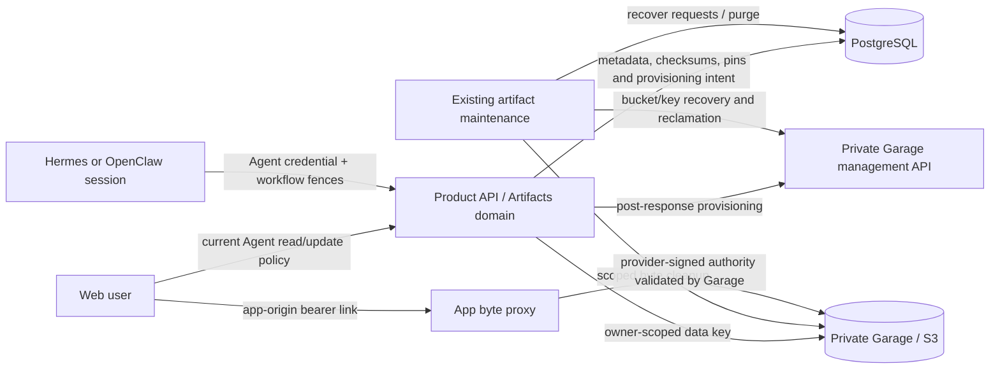
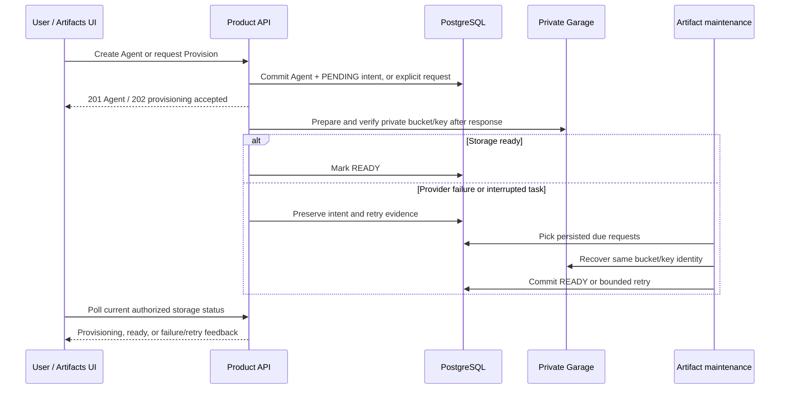

# Agent artifacts and file sharing

Status: AF-415 implementation rebased onto staging, including merged AF-389; not externally deployed. [AF-415 specification](https://aai-labs.atlassian.net/wiki/spaces/AF/pages/3089039363) and [AF-387 delivery log](agent-workflows/CHANGELOG.md).

## Architecture

The diagrams summarize the contracts below. Runtime Agents receive no S3 data or
management credentials, and all download authority is validated by the provider.
A process killed before recording its result is recovered from the committed
request; the post-response task is not the durability boundary.

## Ownership and access

One shared `artifacts` domain serves ordinary Agent sessions and workflow steps
on Hermes and OpenClaw. PostgreSQL owns metadata and reference identity; private
S3-compatible storage owns bytes. Garage is the selected deployment target.
An artifact belongs to exactly one Organization and Agent. Workflow, run, step,
attempt and generation provenance are optional and server derived. Keys have the
fixed form `artifacts/<organization UUID>/<agent UUID>/<artifact UUID>` and never
include user filenames. Replacement always creates a new artifact ID.

Human metadata/list/download-link reads require current Membership, `agent.read`
and the scoped undeleted Agent under the [RBAC brief](rbac/IMPLEMENTATION-BRIEF.md).
Human staging, publication and deletion require `agent.update`; read-only Personal
API Keys cannot mutate. Agent General Access and custom roles use the existing
policy. Cross-tenant, wrong-Agent and inaccessible resources return 404; missing
write authority on a visible resource returns 403. No artifact-specific roles or
cross-Agent sharing grants are introduced.

Runtime requests use a purpose-separated HMAC capability derived from the
Agent's existing per-start ingest secret. The credential contains the Agent UUID;
the service verifies it against the persisted encrypted secret and a running,
undeleted Agent. It rotates on restart and stops resolving when the Agent stops.
The API derives Organization/Agent identity; callers cannot supply another bucket
or object key. Agents receive no S3 credentials. Ordinary chat publication needs
no workflow. Workflow publication additionally requires the current attempt ID,
run generation/state/deadline, authenticated owning Agent and current initiating
Membership authority. Those fences are checked before storage and again before
READY. Only the artifact lock crosses S3 I/O; finalization releases that lock before
acquiring run then artifact locks and repeating the fence. Cancellation and completion
can proceed during upload; an intervening attempt/deletion change prevents READY.
Agent-scoped tools remain available in ordinary sessions. The completion bearer is
held by the trigger server and never enters the model prompt or file-tool arguments.
Human publication cannot attach bytes to a workflow-staged artifact.

The owning Agent is the runtime trust boundary. Ordinary chat, workflow and
integration-driven sessions share that Agent's runtime identity and tool authority;
any of those sessions can publish files to a current attempt of that same Agent
when it knows the attempt ID. Attempt IDs are provenance identifiers, not secrets
or per-session capabilities. Attempt/generation/deadline and initiating Membership
checks fence stale or unauthorized runs; they do not authenticate which session
created the bytes. This implementation makes no isolation claim between sessions
of one Agent. Protecting mutually untrusted sessions would require a separately
approved execution/credential boundary.

## Per-Agent storage authority

Every Agent has its own private Garage bucket and a distinct read/write data key.
The server derives its bucket alias as `agent-artifacts-<agent UUID hex>`, with no
configurable installation prefix;
Organization and Agent ownership come exclusively from persisted records. The
key has no owner or bucket-creation permission and cannot read/write another
Agent's bucket, including by its provider bucket ID. Private key-local aliases
are not a substitute for distinct provider buckets.

Agent creation atomically commits a PENDING storage request with the Agent,
creator access and creation events when storage is configured. It returns 201
without waiting for Garage. Post-response API work imports the request's exact
key, creates its private bucket, verifies identity and read/write-only scope,
and commits READY. Storage failure leaves the Agent usable for text with a durable
retryable request. Failed Agent creation rolls back its request before provider I/O.
Deliberately disabled storage creates no request.

Existing Agents are never discovered by a background scan. Their Artifacts view shows
**Artifact Storage Not Provisioned** and a **Provision** action for people with
`agent.update`. `GET .../artifacts/storage` requires current `agent.read` access;
`POST .../artifacts/storage` requires current `agent.update` and returns 202 after
persisting an explicit request. The same post-response work starts provisioning.
Concurrent/repeated requests preserve the same bucket/key identity. READY requests
are idempotent; failed PENDING requests can be retried. No credentials or raw
provider diagnostics appear in status responses.

Storage status is `NOT_CONFIGURED`, `NOT_PROVISIONED`, `PROVISIONING`, `READY` or
`FAILED`. The Artifacts view polls every two seconds while provisioning or failed,
shows progress, and offers **Retry provisioning** after failure. Readers see status
and instructions to ask an editor; they cannot provision. Missing deployment
configuration shows storage unavailable without a Provision action. Files remain
usable alongside status feedback; text conversations never wait for storage.

The existing artifact maintenance worker recovers only persisted requests and
reclaims deleted-owner storage. It serializes bounded provider work on each bucket
journal row and uses bounded exponential retry after uncertainty, reusing exact
key identity and private alias. Post-response tasks accelerate progress but are
not the durability boundary: a crash between commit and task execution is recovered
by maintenance. Local Compose checks every ten seconds; Kubernetes' enabled
maintenance CronJob checks every ten minutes. Operators must enable that schedule
for unattended recovery. There is no separate provisioner process or queue.

`artifact_bucket` retains Organization/Agent IDs, provider identity, state and
retry evidence across owner deletion. Its data secret is encrypted with
`AGENT_TOKEN_ENCRYPTION_KEY`; response DTOs and Agent runtimes never receive it.
The API and artifact cleanup worker hold private Garage management authority for
provisioning and recovery/reclamation respectively. Other application workloads and Agent
runtimes receive neither the management token nor data credentials. The API is a
trusted service with access to the encrypted credential catalogue; per-key storage
isolation does not mean isolation between processes serving different Agents.
There is no ambient AWS/workload-identity fallback.

Provisioning requests originate only from the existing authorized Agent-create
flow or the explicit authorized Provision endpoint. Bounded recovery and reclamation run in
the existing artifact-purge worker under the operator-background exception in the
RBAC brief. See [operations](../guidelines/garage.md) for private credential wiring.
This revision assumes no existing shared-bucket files: no shared-bucket byte
migration or legacy access path is implemented.

## Publication and immutable handoff

1. `POST /organizations/{organization_id}/agents/{agent_id}/artifacts` stages
   filename, content type, byte size and lowercase SHA-256, returning UPLOADING.
2. `PUT .../artifacts/{artifact_id}/content` accepts bounded raw bytes. The API
   computes size and SHA-256, writes only matching content, then reads it back
   from S3 and verifies it before committing READY. The service serializes
   byte writing and purge on the same metadata row; READY objects never re-enter
   the byte writer. Garage 2.4.1 ignores conditional Put headers, so immutability
   is enforced by the locked lifecycle and fixed size/checksum, not by an S3
   conditional-write or object-lock promise. Bucket credentials remain service-only.
3. Sequential exact duplicate finalization returns the same READY identity.
   File locks use NOWAIT in both byte writing and finalization; concurrent publication
   returns retryable 409 without marking the artifact failed. A finalizer never waits
   on another S3 writer while holding the run lock. Retry the same artifact ID after
   contention; changed bytes
   cannot replace it. After a failed/uncertain upload, stage a new ID to retry.
   A crash after S3 write leaves UPLOADING metadata for cleanup; it is never
   exposed as a file. Staging expires after one hour. Interrupted/oversized
   request bodies remain unavailable and expire through the same cleanup path.

The default file limit is 25 MiB, configurable from 1 byte to 100 MiB. Uploads
are buffered within that bound; choose API concurrency/memory limits accordingly.
Display filenames are at most 255 characters and cannot contain paths or control
characters, including DEL and Unicode format/bidi controls. Content types are bounded MIME identifiers. All downloads use
attachment disposition and octet-stream; active content has no inline preview.

The domain exposes one composed `agent_artifacts_router` on the product API;
its management, bearer-download and runtime routers retain distinct authentication
dependencies. Runtime tools use `/api/v1/agent-artifacts/runtime` and are excluded
from the public user schema. The previous `/artifact-runtime/v1` path is removed;
refresh any configured `ARTIFACT_RUNTIME_BASE_URL` overrides and update/restart
existing Agents after this change so their generated runtime URL is current.

Both runtimes receive `/usr/local/bin/agentbarn-artifacts` in their generated
ConfigMap and executable mount. `upload <workspace-file>`, `list [--page N]`,
`retrieve <id> <new-path>` and `link <id> [--seconds N]` use the same scoped service.
Upload roots are `/workspace` on Hermes and
`/home/node/.openclaw/workspace` on OpenClaw. Retrieval verifies the expected
checksum and refuses to overwrite a destination. Workflow prompts provide only
`--attempt-id`; the CLI's Agent credential supplies publication authority, not the
completion bearer. The service rejects superseded/expired/unauthorized attempts.
With storage unconfigured, prompts omit the file-tool instructions. HTTP failures
include their status code without echoing credentials, URLs or response bodies.

Shared runtime instructions make file delivery outcome-driven: a request such as
“Create a CSV with three sample products” means create actual bytes, publish the
finished deliverable, and return a concise download link without requiring the
user to name storage or a CLI. Previously published files get fresh links rather
than duplicate uploads. Explicit keep-local requests, ordinary explanations/code
snippets, scratch/intermediate files and unrelated workspace files are not automatic
publication triggers. Existing command approval and messaging policy still apply;
failed creation/upload must not be represented as successful delivery. Replies use
the returned URL unchanged and briefly explain expiry, without dumping internal
IDs/checksums or tool commands. Those identities remain available for handoffs.
Instruction changes require an Agent update/restart and a fresh-session natural
language check on each runtime; generated-prompt tests alone do not prove live
model/tool selection.

Admission caps staged/READY files at 16 per attempt and reserves at most 16,000 UTF-8
bytes of file-reference metadata across a run. These checks serialize on the run lock;
excess staging returns 409 before accepting bytes. Use an archive for larger file sets.
The overall workflow context bound still applies to combined text and file references.

Publication pins an exact artifact ID/checksum to its active run. Completion
records published files in the step checkpoint, so later sessions receive immutable
references alongside earlier text summaries. Workspace paths and signed URLs are
never reference identities. Trusted services can acquire checksum-validated pins
through `artifacts.references.pin` and release them transactionally; this is the
integration seam for future reviews, not an approval implementation. Current workflow
checkpoints are protected by their active run pin. Separate checkpoint/review owners
will release their own pins; the run-repair scan never interprets their owner UUIDs
as run IDs.

## Downloads and ordinary messaging

`GET .../artifacts` supports server-side pagination and optional run/step filters.
`GET .../artifacts/{id}` reads READY metadata;
`GET .../artifacts/{id}/download-link` issues a fresh app-facing bearer URL after current
access checks. The byte-store adapter obtains provider-signed download authority;
the app does not issue its own download tokens or validate provider signatures or
expiry. The default lifetime is 900 seconds. Requests may choose a shorter
lifetime up to the configured maximum (default 3,600 seconds, bounded at 86,400).
URL expiry does not delete bytes or expire an approval. Anyone holding an issued
URL can download until expiry; revocation prevents new issuance and does not
promise immediate revocation of existing URLs. Object deletion may make links
unavailable sooner.

Downloads use the existing configured `WEB_APP_URL` and
`GET /api/v1/agent-artifacts/{organization_id}/{agent_id}/{artifact_id}?access=…`.
The `access` value is opaque provider authority, not an application-issued token.
The provider adapter transports only the signed query, never its private origin,
bucket or key. At download time the API resolves that exact persisted tenant/Agent/file
through its scoped Agent join and asks the adapter for a stream. The adapter rebuilds
the private target from configuration and metadata, then makes an **unauthenticated**
provider GET with the supplied signed authority. It never substitutes a service-key
read, accepts a caller-supplied proxy target, follows redirects or forwards app
cookies/Authorization. The provider decides signature validity and expiry; changing
the target file or signed authority fails there. Invalid/expired/missing targets
return a concealed 403, storage outages return 503, and provider error bodies and
headers are not relayed. The app has no second signing or URL-lifecycle system.

The response streams bounded 64 KiB chunks, closes upstream on completion or
client cancellation, uses the persisted filename and size, forces attachment and
octet-stream, and sets private/no-store, nosniff and no-referrer headers. This
capability-only byte route does not require a login cookie; URL issuance still
requires current human/runtime authorization. Membership revocation prevents new
issuance, but existing bearer authority does not depend on the issuer's session.
The external app path and opaque `access` contract do not depend on S3; another
`ArtifactStorage` adapter can replace it without changing clients. Access query
values are redacted from API access logs; operators must redact them at any ingress
or external logging proxy too.

Garage is private: Compose API/purge reach `garage:3900`, while a loopback-only
host port serves native development/operators. Application deployments create no
Garage public ingress. `ARTIFACT_S3_ENDPOINT_URL` is internal-only; no separate
public-storage URL is required. Runtime `retrieve` uses the app byte route through
its configured reachable API origin while keeping opaque provider authority intact;
restart existing Agents to load this CLI change. See
[download delivery operations](../guidelines/garage.md#download-delivery).

The Agent Artifacts view shows READY chat, human and workflow files with names,
sizes, types, provenance and download actions. File rows use recognizable type
icons with a generic fallback, based on the filename extension or MIME type.
Download controls include an icon and retain an accessible filename label on small
screens; SHA-256 remains available in the quieter checksum line. Run/step attachments use the same
service alongside existing text summaries. Each click requests a fresh link;
access errors conceal protected responses and display a retryable failure.
People with current `agent.update` access can delete from Agent Artifacts using the
trash action and the shared destructive confirmation dialog. The dialog identifies
the file, keeps failures visible for retry, and explains active-run/review pin
conflicts. Successful deletion refreshes Agent and run/step file lists; read-only
users see no delete control. Storage cleanup follows the existing
[deletion lifecycle](#retention-deletion-and-recovery).

Download errors appear beside the affected file, leaving other files usable.
Authenticated link issuance returns 409 for a file in the previous shared-storage
layout, explicitly explaining that migration or re-upload is required; it never
substitutes another Agent's credential or silently migrates bytes. Missing usable
credentials for the current layout return a distinct 503 explaining that Agent
storage provisioning needs checking. No bucket/key or private endpoint is exposed.

Artifacts uses `useInfiniteQuery` with 20 records per request and loads the next page
when the scroll sentinel approaches the viewport. Loaded pages stay visible during
additional-page failures, with an explicit retry; exhausted lists stop fetching.
The API orders by creation time and ID descending for stable timestamp ties.
Query identity includes Organization, Agent, run, step and infinite-list mode. Workflow files
show their attempt identity, including outputs retained from superseded attempts;
the list does not claim all such files were accepted checkpoints. File polling follows
progressing runs and stops when settled or parked. Download URLs must use HTTP(S).

CLI publication returns actual identity/checksum and a signed URL. The Agent may
share it using existing native messaging tools under its configured policy.
Publication/link creation does not authorize or perform an external send. Workflow
steps remain sessions inside the existing owning Agent with its current tools,
Integrations, approval policy and spend limits.

## Retention, deletion and recovery

Ordinary unpinned files retain for 30 days from publication. Active run/checkpoint
or future pending-review references prevent expiry. Settlement releases run pins
in the same transaction and starts 30 days from final active reference release.
Paused/blocked runs remain pinned. Cancellation retains published outputs and
releases pins on settlement. This is independent of the workflow's 90-day
content-bearing text/history retention and future approval lifetimes.

A Task File pins its artifact with kind `task`, owned by the Task File's id, for as
long as the Task has it ([`agent-tasks.md`](agent-tasks.md#task-files)). Deleting
the Agent removes its Tasks without releasing those pins; the purge removes a
deleted Agent's files regardless.

Deletion refuses an actively pinned artifact. Authorized deletion conceals it by
marking DELETING; actual S3 deletion is asynchronous. Agent soft deletion
immediately conceals all files through scoped queries. Owner and provenance IDs
intentionally have no cascading FKs: hard deletion cannot erase the S3 cleanup
journal. The operator-only bounded purge detects deleted/missing owners,
expired unpinned files, stale uploads and prior deletion failures. It repairs
run references whose run was removed, and locks/validates the exact stored bucket and
canonical tenant key before deleting. Failures retain DELETING evidence, increment
attempt count and use bounded exponential retry delay, including refused unsafe targets.
Releasing references never postpones a DELETING row's pending retry. Cleanup
selection is provisional: after acquiring the artifact lock, a fresh statement
rechecks active references for a live owner before marking DELETING. Pin acquisition
uses the same lock; a pin committed after the selection snapshot still protects
the file. Deleted/missing-owner cleanup retains its deliberate reclamation policy.
Concurrent publication and purge serialize; DELETED tombstones retain identity
without file bytes.

For a deleted/missing Agent, artifact cleanup marks its bucket DELETING
but retains its data key until **every artifact is DELETED**, not merely unpinned.
It then refuses nonempty/shared buckets, deletes the empty bucket and revokes its
key. Only after both provider operations succeed does it commit a DELETED bucket
tombstone and clear the encrypted data secret. Failed/uncertain cleanup retains
identity and credentials for retry. An empty bucket belonging to a live Agent is
not reclaimed.

Storage disabled or unavailable returns truthful artifact errors without blocking
chat or text-only workflow results. Failed uploads are never READY. See
[Garage operations](../guidelines/garage.md) for persistent local/cluster setup,
migrations, rollback and recovery. [Evidence](agent-artifacts/EVIDENCE.md) separates
local real-storage/runtime contracts from unperformed live deployment acceptance.
