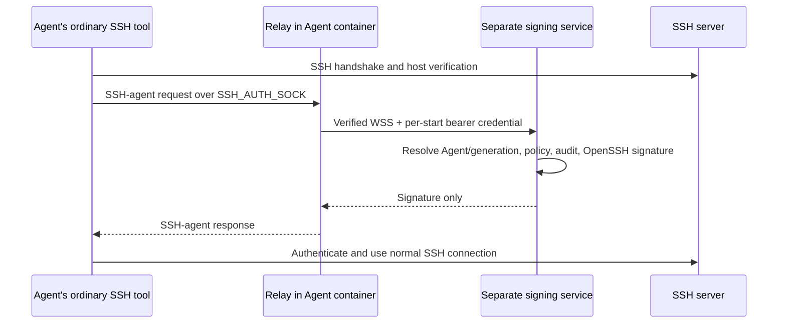

# Shared SSH access

Agents use ordinary `ssh`, Git over SSH, `scp`, and `sftp` through their terminal tools. Organization-owned SSH Credentials keep private keys in Agent Barn's encrypted database and signing service. The Agent receives a local SSH-agent socket and a per-start signing credential, never the private key. This is independent of provider Integration credential isolation.

## Ownership and authorization

Organization Owner/Admin can generate an Ed25519 key or import an OpenSSH/PEM Ed25519, RSA (at least 2048 bits), or NIST ECDSA private key in **Settings → Shared Credentials → SSH**. Imported encrypted keys accept a passphrase for that request; the normalized private key is encrypted with `AGENT_TOKEN_ENCRYPTION_KEY`, and the passphrase is not retained. Generated private keys cannot be downloaded. Responses expose public key, SHA256 fingerprint, algorithm, origin, policy, revision, enabled state, and attachment count only. Names and public fingerprints are unique within an Organization.

Organization Members may inspect that Organization's public credential catalogue. Reading an Agent's selection requires `agent.read`; changing it requires both `agent.update` and `agent.secret.manage`, and restarting additionally requires `agent.lifecycle.manage`. Agent queries apply the RBAC visibility predicates in repositories. Composite foreign keys prevent cross-Organization attachments. Platform administration gives no implicit Organization access. A key cannot be deleted while attached to a non-deleted Agent; disable it to revoke access first.

The API exposes Organization-scoped `/ssh-credentials` CRUD (`PUT /ssh-credentials/{id}` replaces editable metadata/policy) and `GET/PUT /agents/{agent_id}/ssh-credentials`. Updates carry `expected_revision`; concurrent edits return 409. An Agent can attach up to 32 keys. Assignments remain a separate contract from provider Agent Secrets. The Shared Credentials navigation is visible to Members; management controls remain administrative.

## Destination policy

The assignment-to-key foreign key uses `ON DELETE NO ACTION DEFERRABLE INITIALLY
DEFERRED`: it checks consistency at transaction commit so an Organization
hard-delete can complete its sibling Agent/key cascades in either order. A
standalone deletion of an assigned key still fails at commit; the API commits
before reporting success. Key deletion does not cascade to live assignments.

Every key has an explicit mode. **Restricted** is the default; an empty server list grants no use. Each server has a unique short name, hostname, port, username, and one or more verified public host keys. Administrators must obtain those keys through a trusted channel; collecting an unverified key does not establish trust. **Unrestricted** deliberately permits general signing with that key; only the remote account and server configuration then limit its use.

For restricted keys, the signing service loads OpenSSH destination constraints using `ssh-add -h` and an isolated public known-hosts file. OpenSSH validates `session-bind@openssh.com`, the host's signature, the SSH authentication payload, and remote username. The protocol accepts first-hop binding only and rejects forwarded binding. Restricted clients must support OpenSSH destination constraints/session binding (OpenSSH 8.9 or newer); both shipped runtime images provide compatible clients. Agent mutation/provider/lock operations are refused.

The enforced destination is the server's **host-key identity and username**, rather than a cryptographic hostname or port. Two machines sharing a host private key are indistinguishable to this policy. Hostnames and ports configure client connections; they do not replace network restrictions. Client `known_hosts` also fails closed for unknown/changed keys. The Agent can modify its own client configuration, but cannot override signer-side restrictions. An unrestricted key may connect elsewhere after a trusted host key has been installed in the ephemeral known-hosts file.

## Runtime and signing boundary

`AgentService` creates a random signing token after the integration runtime generation begins. Only its hash is stored in `ssh_runtime_credential`; plaintext is projected into that Agent's Kubernetes Secret. The machine-only `api.ssh_main` listener resolves tenant, Agent, and generation exclusively from this hash. The Agent must be undeleted, RUNNING, and in the matching provisioned/ready generation. It cannot select another Agent, Organization, or database key path.

Both runtimes receive `SSH_AUTH_SOCK=/run/agentbarn-ssh/agent.sock`, `AGENTBARN_SSH_SIGNER_URL`, `AGENTBARN_SSH_SIGNER_TOKEN`, and, for a private CA, `AGENTBARN_SSH_CA_FILE`. Public ConfigMap files contain the relay, server profiles, and optional CA certificate. An init step owns a dedicated memory-backed `emptyDir` for the runtime UID. Startup writes public identities, SSH configuration, and pinned host keys there, creates a mode-0600 Unix socket in the mode-0700 directory, and prepends its managed Include to `~/.ssh/config`. No private key or socket is written to the Agent PVC or restore archive. The runtime image contains the relay's isolated Python environment at `/opt/agentbarn-ssh`.

A Bot receives its own `SSH_AUTH_SOCK=/run/agentbarn-ssh/<bot-id>/agent.sock`
and generation token. The Parent Agent's pod mounts ephemeral SSH storage when
any served Bot needs it, even when the Parent Agent has no assigned keys. The
common relay serves each socket with its owning Agent's token and CA; public
aliases and host pins share the pod's SSH configuration. SSH resolves
`IdentityAgent ${AGENTBARN_SSH_DIRECTORY}/agent.sock` from the owning profile's
environment, including when several Bots share the same key. Hermes passes the
socket and directory through the profile's terminal environment. OpenClaw's Bot
exec hook passes the directory from the Bot's own Secret and leaves the protected
`SSH_AUTH_SOCK` variable out of exec overrides. This preserves attribution,
not isolation: [Bots share one workload trust boundary](agent-bots.md#what-bots-share).

Profiles receive stable aliases `ab-<full-key-UUID-without-hyphens>-<server-name>`, listed in the Agent's SSH settings and generated `AGENTS.md`. Normal `ssh <alias>` and `git clone <alias>:<repository>` discover the socket and public identity automatically. Every local Unix connection owns one authenticated WSS connection and one isolated OpenSSH `ssh-agent`; messages remain ordered so session binding cannot leak between clients. There is no generic execution endpoint. Decrypted keys are supplied to OpenSSH through stdin, never temporary private-key files. Signing processes disable core dumps.

## Apply, revocation, and failure

Adding a key to a running Agent requires explicit Apply & Restart. A stopped Agent saves its selection for its next start. Lifecycle preflight validates the proposed materialization before stopping the current Agent; the lifecycle lock covers selection and restart. Disabled SSH or a missing/invalid signer URL rejects starts with assigned keys before teardown. A signer network outage refuses SSH operations while the Agent can otherwise run. Disabled keys remain assigned and do not sign.

For a Bot, Apply & Restart requires `agent.lifecycle.manage` on its Parent
Agent and restarts that Parent Agent and all served Bots. Selection changes
use the Parent Agent's lifecycle lock, managed-update guard, and restore guard;
the Bot's proposed SSH configuration is preflighted before interruption. A Bot
in error still needs this restart when its Parent Agent is running. No Bot
deployment is created. The UI explains the shared restart and uses the Parent
Agent's status and permissions.

Assignment removal, key disable/policy changes, stop, failed start, deletion, and generation replacement are checked on the next protocol request. A changed connection key/revision snapshot closes that connection; new connections use the current policy. Re-adding a removed key does not restore the old token's applied grant. Policy/profile changes mark settings pending: signer policy changes immediately, while client aliases and pins update at restart. Existing SSH sessions and signatures already issued cannot be revoked; a request racing a policy change may already have been authorized. Revocation limits future authentication, not commands on an established remote session.

The relay requires verified `wss://`, makes no automatic request replay, and refuses operation if TLS, authentication, authorization, OpenSSH, or durable audit fails. Frame size is 256 KiB. Defaults cap each signer replica at 64 connections, each Agent at 8 per replica, and idle connections at 60 seconds. The local relay independently caps each Agent at eight connections. Backend operations and relay responses also have bounded timeouts. Limits are per replica, not a distributed quota.

## Audit and limits

Key creation/change/deletion and assignment changes use transactional Domain Events. Each valid signing request records `ssh.signing.authorized` before OpenSSH and `ssh.signing.issued` or `ssh.signing.refused` before returning its result. Events contain owning Organization/Agent, key ID/fingerprint/revision where known, request correlation, outcome, and bound public host fingerprint. The Security Audit projection consumes these events. Private keys, passphrases, bearer tokens, raw protocol payloads, remote command strings, and output are excluded. A missing completion event after authorization indicates an interrupted attempt, not proof that a signature reached a client.

SSH events initially leave deliveries `PENDING`; the existing Event Delivery
reconciler publishes them for the audit worker. The signing process has no Redis
credentials or egress. PostgreSQL audit intent is synchronous, while Security
Audit projection can lag by the reconciliation interval and worker backlog.
Keep the existing reconciler and event worker enabled.

This service sees authentication, not the encrypted remote SSH command stream. Existing Agent terminal Tool Call telemetry remains available but is not a complete or tamper-resistant remote command record. Remote account permissions remain responsible for allowed operations. A recording SSH gateway or execution broker would be a separate future boundary. Bearer-token theft can impersonate that Agent until revocation; the entire Agent workload shares one identity. This does not protect against an administrator of the signing host, database plus encryption key, or Agent pod credentials.

The internal `/metrics` endpoint exports `agentbarn_ssh_connections` and
`agentbarn_ssh_signatures_total{outcome="issued|refused"}` without Agent/key/host
labels. It is not ingress-routed; operators must configure their internal scrape
access explicitly. Health and metrics are process diagnostics, not proof that a
destination can be reached or that database/audit persistence is available.

## Change surfaces

The owning API domain is `api/domains/ssh/`; `api/ssh_app.py` is the machine boundary. Agent lifecycle, runtime builders/start scripts, both base images, Domain Events/Security Audit, the SSH UI feature, migration `a193d7f0c284`, and optional Compose/Helm deployment move together. See [operations](../guidelines/operations.md#ssh-signing-deployment), [verification](../guidelines/testing.md#shared-ssh-access-verification), and the [decision](../adr/2026-11-14-shared-ssh-through-server-side-signing.md).
