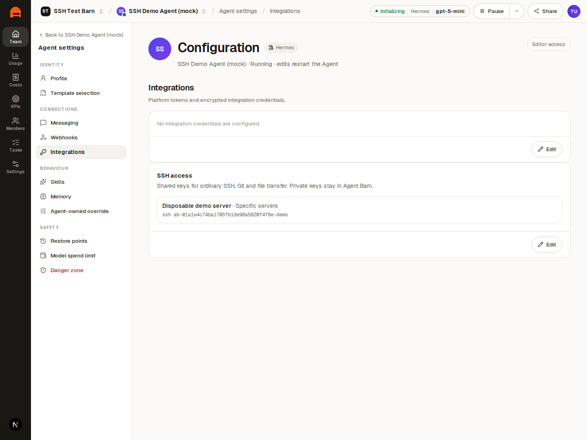

# Shared SSH access — execution evidence

Observed: 2026-11-16 (Europe/Berlin)
Tested implementation: `ee7e5a9c81b8c73cda9f731a35eb06cf6fddd261`, based on staging `d39a4b43`.
The following evidence/documentation commit changes no executable source.
The settings layout and CI fixture follow-up were tested at
`44575f716dd0230b028bfeaba65df8f2d5c11484`; the original feature checks below
remain attributed to `ee7e5a9c`.

## Environment and boundary

A local Agent Barn product API and Next.js UI ran with a dedicated PostgreSQL 18
database and Redis instance. The only Agent was **SSH Demo Agent (mock)** in
**SSH Test Barn**, configured as Hermes. Kubernetes resource creation and LiteLLM
provisioning used the repository's test adapters. A real Hermes container ran the
generated relay and native `terminal_tool`; a separate real signing listener used
verified TLS, the real database and OpenSSH. Disposable Debian SSH servers accepted
only the generated public key. No production credentials or paid model calls were used.

The Agent's read-only configuration bind mount contained only the relay, public
profiles and public CA certificate. Its socket directory was owned by `hermes`
with mode 0700 and its socket mode was 0600. The Hermes image also creates its
ordinary empty `/opt/data` volume; it was not a private-key mount.

The production Kubernetes scheduler, actual model turn loop, external providers,
production ingress and cluster NetworkPolicy enforcement were not exercised by
this mock demo. The separate runtime contracts execute both generated volume-owner
init commands in the actual images before checking native terminal use.

## Acceptance criteria and proof

| Criterion | Observed proof |
| --- | --- |
| Ordinary SSH, Git and file transfers work without delivering the private key to the Agent. | [Native terminal transcript and public mounts](evidence/live-demo.json): SSH returned `ssh-demo-connected` and `root`; Git clone/commit/push/fetch succeeded; scp/sftp returned the original `ssh-demo-file`. Both runtime contracts passed. |
| Administrators can generate/import keys and receive only public metadata. | Real browser generation and deletion succeeded against the live API; [API request/response evidence](evidence/live-demo.json) contains no private material. `test_import_encrypted_key_duplicate_key_and_safe_validation` and generation tests passed. |
| Access is scoped by Organization and Agent authority. | Real Member login could inspect the public key but had no create/save controls ([UI states](evidence/ui-states.json)). API role cases covered Owner, Editor, Viewer and concealed/unassigned Agents, plus cross-tenant foreign keys. |
| Restricted signing refuses unapproved host identities, wrong accounts, forwarding and keyring mutation. | The second disposable server accepted the same public user key but had a different host identity; authentication failed even with client host checking bypassed ([transcript](evidence/live-demo.json)). Wrong-user, forged-binding, forwarding, mutation and malformed-frame API cases passed against real OpenSSH. |
| Revocation and restart generations change future authentication authority. | Disabling the key caused a fresh native SSH command to fail; re-enabling and Apply & Restart issued a new generation that returned `fresh-generation-connected`. Generation replacement and remove/re-add regression tests passed. |
| Signing audit is durable and failure prevents release of a signature. | [Audit projection evidence](evidence/audit-projection.json): reconciliation published 34 deliveries to the dedicated Redis; direct execution of the real delivery processor completed 26 SSH projections, including eight authorized and eight issued signing records. Both pre-sign and result-audit failure cases refused the connection. |
| The UI supports loading, empty, failure/retry and permission states without breaking adjacent integrations. | [Live UI state checks](evidence/ui-states.json): a held real request displayed loading, unmatched real search displayed empty, controlled HTTP 503 displayed Retry, and Retry recovered real data. The adjacent empty provider-integration section loaded. 29 selected browser checks passed. |
| Deployment remains opt-in and the schema and runtime setup are compatible. | Enabled/disabled Helm renders and migration checks passed; downgrade preserved keys until explicit deletion. Both runtime images executed the generated init argv successfully and produced the expected ownership/0700 permissions. |

## User-facing flow

1. Sign in through `/login` using the local Organization Owner fixture.
2. Open **Settings → Shared Credentials**. Inspect the disposable key and its
   specific-server policy. Add a generated key, verify the public identity, and
   delete that unattached key through the confirmation dialog.
3. Open **SSH Demo Agent (mock) → Configuration → Integrations**. Verify its
   assigned SSH key and generated `ssh ab-<key-id>-demo` shortcut.
4. Run the native terminal commands preserved in [live-demo.json](evidence/live-demo.json).
5. Change the destination to the unapproved host fixture while bypassing client
   host checking: authentication still fails at the signer boundary.
6. Disable the shared key through `PUT /ssh-credentials/{id}`: a fresh command
   fails. Re-enable, Apply & Restart, and verify a fresh generation succeeds.
7. Sign in as the local Member fixture and verify that inspection is read-only.

The successful UI pass used real password authentication and the actual HTTP API,
with no fabricated browser API data. The loading/outage checks separately held
one request or supplied controlled HTTP 503 responses; those controlled failures
are not claims that the real API returned 503.

## Screenshots

These are ordered captures from successful flows against the real local API,
not mocked save responses. The generation flow uses a temporary unattached key;
the assignment flow uses the existing disposable server's configured key.

| Step | Screenshot and observed result |
| --- | --- |
| 1. Generate a shared key | [Completed key form and Save action](evidence/01-generate-key.png). |
| 2. Key creation succeeds | [Saved public identity](evidence/02-key-saved.png); no private key is returned. The temporary key was subsequently deleted. |
| 3. Select access for an Agent | [Checked shared key and Apply action](evidence/03-select-key.png), using a fresh stopped **SSH setup example** Agent. |
| 4. Confirm the change | [Apply confirmation](evidence/04-confirm-access.png) explicitly keeps this Agent stopped. |
| 5. Verify the saved result | [Assigned key and SSH shortcut after reloading](evidence/05-access-saved.png). The real PUT returned 200; settings correctly remain pending until the next start. |
| 6. Check phone layout | [390-pixel layout](evidence/06-access-mobile.png): the access badge clears the title, and the SSH shortcut wraps without horizontal overflow. |

[Shared Credentials overview](evidence/shared-credentials.png),
[public identity and configured server policy](evidence/key-policy.png),
[existing running mock Agent](evidence/agent-access.png),
[successful assignment observations](evidence/happy-path.json).

The temporary stopped Agent was deleted after capture; the existing running
Hermes demo was not restarted by this UI check. Its actual SSH execution proof
is the separate [native terminal transcript](evidence/live-demo.json).




## Settings layout follow-up verification

The Integrations and SSH sections now have a 32-pixel gap and matching headings
outside their cards. Assigned SSH keys use plain rows inside the settings card;
selection uses a background highlight instead of another bordered card. Long
aliases wrap on narrow screens. The Configuration title and access badge no
longer overlap at the checked 390-pixel width.

At `44575f71`, real browser creation, selection, confirmation, successful save,
reload and mobile inspection passed without browser page errors. Twelve selected
Playwright checks passed (`ssh.spec.ts` and `integration-setup.spec.ts`, including
the authentication setup). `make check-api`, `make check-ui`, `make lint-ui`, and
`git diff --check` passed. The successful screenshots were visually inspected.

The preceding CI SSH image checks failed because the disposable server's
read-only `authorized_keys` bind mount retained the runner's ownership. The
fixture now copies its inputs into root-owned server files and retains
`StrictModes yes`. A local ownership reproduction failed with exit 255 before
the fix and returned `owner-fixture-success` afterwards. Both actual runtime
SSH contracts passed again (2 tests); the production signing code is unchanged.

The same CI API run also found two stale contract expectations: the reviewed v1
inventory omitted the seven new SSH operations, and the ConfigMap scanner treated
the token-guarded relay as mandatory for SSH-disabled Agents. These expectations
and the public API resource guide were updated at
`c1b1200b08e6f1369045d666f2c1f8662b7776ff`. The focused regression run passed
47 checks; API lint, format, and type checks passed again. Repository CI must
still rerun before merge; this is not a claim that the full suite passed locally.

```bash
PYTEST_XDIST_AUTO_NUM_WORKERS=2 REDIS_URL=redis://127.0.0.1:1/0 \
PYTEST_ADDOPTS='-k "test_ssh or runtime_config_map_contract or public_api_contract" --tb=short --show-capture=no -q' \
make test-api
```

## Automated verification at the tested commit

```bash
make check-api
make check-ui
make lint-ui
make check-ssh
make check-migrations
git diff --check
```

All passed. Compose and changed GitHub workflow YAML also parsed successfully.
API and both runtime Docker images built successfully from this source tree.

```bash
PYTEST_XDIST_AUTO_NUM_WORKERS=4 \
REDIS_URL=redis://127.0.0.1:1/0 \
PYTEST_ADDOPTS='-k "ssh or credential_gateway or shared_credential or custom_api or test_agents or openrouter_client or domain_events or agent_runtime_digest or restore_point_builders or restore_point_manifest" --tb=short' \
make test-api
```

632 selected API/unit/integration checks passed. This is a regression selection,
not a claim that the complete API suite ran. The deliberately unavailable Redis
address isolates these tests from unrelated host services; durable outbox writes
use real per-worker PostgreSQL databases. Real Redis delivery was verified
separately in the local demo described above.

```bash
HERMES_TEST_IMAGE=agentbarn-hermes-base:ssh-pr \
OPENCLAW_TEST_IMAGE=agentbarn-openclaw-base:ssh-pr \
REDIS_URL=redis://127.0.0.1:1/0 \
PYTEST_ADDOPTS='--tb=short --show-capture=no -q' make test-ssh-runtime

(cd ui && pnpm exec playwright test \
  tests/e2e/ssh.spec.ts tests/e2e/shared-credentials.spec.ts \
  tests/e2e/integration-isolation.spec.ts tests/e2e/integration-setup.spec.ts)
```

Both runtime contracts and all 29 selected browser checks passed. The automated
browser suite uses mocked APIs; the manual screenshots and UI checks above use
the running API. Existing dependency deprecation warnings were non-fatal.

## Behavior-focused test follow-up

Tested at `8f20e0931f427bbc5f0cbc7310cfa3b4ee01b4c8`: credential management
and permission scenarios now use reusable domain-named Given steps, one user
action per scenario, and PyHamcrest assertions on API responses, persisted
selection and durable audit. Independent generation/import, duplicate identity,
validation, deletion, stale-edit and permission behaviors were split out of the
original bundled tests. The four member roles and four SSH operations are
independent cases, so a refusal does not prevent another permission case running.
The existing real TLS/OpenSSH, generation, tenant and audit-failure contracts remain.

The staging regression command below passed again: **183 selected checks**,
including the separated scenarios. API lint, format and type checks passed.
These are the same production behaviors with clearer tests; this follow-up does
not change executable application code or require new UI captures. The routed
code/testing guides link the requested DDD and GivenPy references while retaining
the repository's feature structure, local GivenPy helpers and test isolation.

## Review limits and delivery

Staging integration (`bc6cf138`, 2026-11-16) retained both deployment-guide
sections and moved the unreleased SSH migration after the new provider migration
`22b93965859f`. The merged tree passed 157 selected SSH, provider, public API,
runtime ConfigMap, OpenRouter, LiteLLM and event checks, plus 12 browser checks
for SSH and Platform LLM providers. API lint/format/types, UI types/ESLint, the
single migration-head check and SSH chart checks passed.

```bash
PYTEST_XDIST_AUTO_NUM_WORKERS=4 REDIS_URL=redis://127.0.0.1:1/0 \
PYTEST_ADDOPTS='-k "ssh or runtime_config_map_contract or public_api_contract or llm_provider or openrouter_client or domain_events or litellm_client" --tb=short --show-capture=no -q' \
make test-api
(cd ui && pnpm exec playwright test tests/e2e/ssh.spec.ts tests/e2e/platform-llm-providers.spec.ts)
```

The ADR and current contracts live in [Shared SSH access](../ssh-access.md) and
its linked documents; this file records observations only. Rollout order and
rollback are in [operations](../../guidelines/operations.md#ssh-signing-deployment).
The feature defaults off. The chart is 0.20.0; compatible runtime versions start
at Hermes 0.2.12 and OpenClaw 0.7.9. Migration `a193d7f0c284` follows staging head
`22b93965859f` after the staging update; no existing provider credentials are converted.

Cluster-level ingress/network enforcement and paid provider/model execution are
unverified here. The audit processor was invoked directly after real broker
publication; background worker scheduling itself was not part of this manual
check. No recording SSH gateway or command-level policy is claimed. Existing
remote sessions survive revocation, and authentication audit is not a complete
remote command log. An epic change log is N/A: this is one implementation PR.
